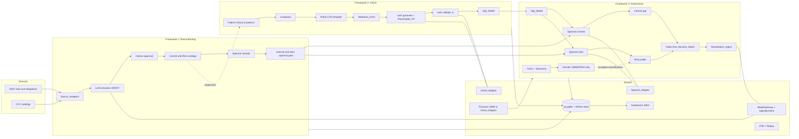
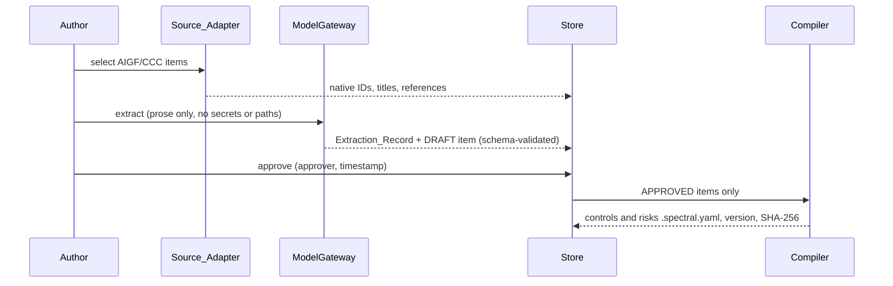
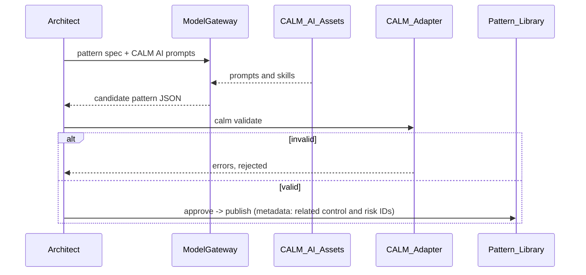
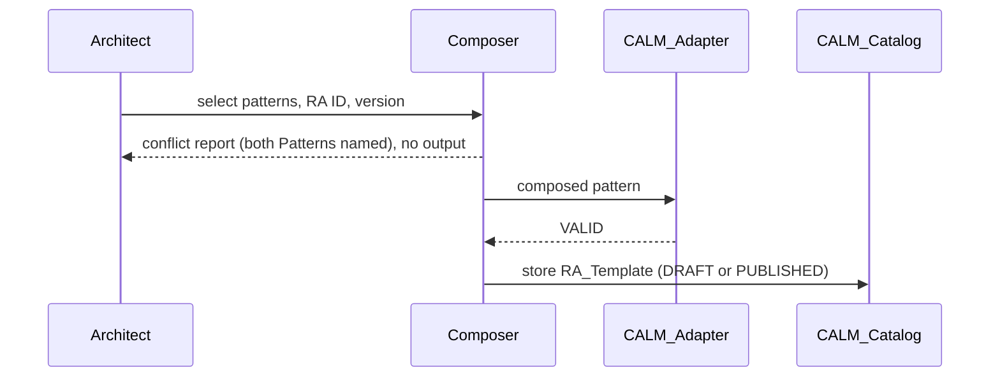
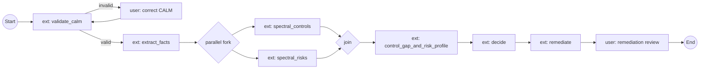

# Design Document

## Overview

The Platform is built in the new repository `ai-governance-intelligence-platform`. It has three frameworks that share a contract layer, a store, and a set of adapters:

1. **Rule Authoring**: AIGF/CCC sources -> LLM extraction (DRAFT) -> human approval -> two catalogs -> two Spectral rulesets.
2. **CALM**: Pattern Library -> Composer -> RA03-LITE template -> Attributes_Form -> `calm generate` -> Placeholder_Fill -> `calm validate -p`.
3. **Governance**: Facts -> Decider (UNMAPPED only) -> two parallel Spectral runs -> control gap and risk profile -> gates -> Decision_Matrix -> remediation.

Items marked **[spike]** (CLI flags, output shapes, REST paths) are unconfirmed and are taken from `spike-notes.md` once Requirement 2 has run.

### Verified facts used by this design

- `calm generate` takes ONE pattern and uses no LLM. It emits `const` values as-is, writes placeholders `[[ NAME ]]`, `[[ BOOLEAN_X ]]`, `[[ REF_X ]]`, and `-1` for numbers. Option choices are keyed by option unique-id, with the choice description as value.
- Spectral: `spectral lint <file> -r <ruleset> -f json [-o out] [-F severity]`. Severities are `error|warn|info|hint`. Exit code 1 only for results at or above the fail-severity, so the adapter must parse JSON and not rely on the exit code.
- Decider: `POST /v1/systemone` with `{state, questions, model, images}`; question types `noul`, `choice`, `score`; response `{model, answers, usage}`.

### Decision table

| # | Decision | Choice | Reason |
|---|---|---|---|
| D1 | Rule engine | Spectral (replaces `evaluator.py`) | Standard linter, JSONPath over CALM, Rule_Code is a join key |
| D2 | Catalog vs ruleset | Catalog holds severity, mandatory, remediation, likelihood, impact; ruleset holds only what Spectral needs | One definition per fact (Req 5) |
| D3 | Severity | Matrix lookup (likelihood x impact) in Scoring_Profile | Never summed, never the tier (Req 18) |
| D4 | `risk_tier.py` | Approval tier only | Req 1.5 |
| D5 | Composer | Own deterministic Python component | `calm generate` accepts one pattern |
| D5a | CALM Pattern RA Generator | LLM (ModelGateway, Strands behind the runtime adapter) proposes Pattern candidates and RA Pattern selections; Composer builds the template; human approval before publish | Generated content stays a candidate; the deterministic path produces the final artifact |
| D6 | Instantiation | `calm generate` + deterministic Placeholder_Fill | Reproducible, no LLM |
| D7 | LLM use | Authoring and remediation only, recorded | Assessment path runs with no LLM |
| D8 | Decider | Accepted Classification (Option B): eligible UNMAPPED facts with no deterministic mapping only; an answer passing the acceptance policy becomes a recorded `AcceptedClassification` (fact -> `INFERRED`, raw kept); HUMAN_REVIEW persists a `human_task`; ABSTAIN/ERROR stay UNKNOWN/UNMAPPED | Cannot set likelihood, impact, severity, control status, gates or decision |
| D9 | Executor | Fluxnova behind a 30 min spike, else Direct_Adapter | Req 22 |
| D10 | Store | py-pglite TCP 5433, files on disk, YAML seed fallback, SQLite last resort | Req 23 |
| D11 | Tests | pytest + hypothesis on a pure core, tools stubbed | Req 26.9 |
| D12 | CALMGuard | Concepts and assets only | Fixed decision 3 |

## Architecture



## Repository scaffold

```
ai-governance-intelligence-platform/
  pyproject.toml            README.md   (single root project: `uv sync && uv run pytest`)
  docs/                     STRUCTURE.md  REUSE.md  deliberate-changes.md  spike-notes.md
  scripts/                  demo.sh
  tests/                    test_consistency_guards.py  test_framework_boundaries.py
                            test_import_all_modules.py
  shared/
    src/agip_shared/        contracts.py (Rule basis, AgentTask, AgentResult, Fact, Decision ...)
                            hashing.py paths.py
                            gateway/ model_gateway.py runtime_strands.py recorder.py
  rule-authoring-framework/
    src/rule_authoring/     transform.py ingest_finos.py sources_aigf.py sources_ccc.py
                            extraction.py compile.py consistency.py approval.py
    catalogs/               seed/registry.yaml  seed/rules/*.yaml
                            controls.catalog.yaml  risks.catalog.yaml
    rulesets/               controls.spectral.yaml  risks.spectral.yaml  functions/
    templates/              rule.yaml.j2
    prompts/                extraction.v1.md
    docs/                   AUTHORING-GUIDE.md  examples/mi-*.md
    fixtures/recordings/llm/
    tests/                  test_rule_schema.py  test_seed_catalog.py  (+ new tests)
  calm-app-generation-framework/
    src/calm_generation/    calm_finos.py  validate_v12.py  composer.py  placeholders.py  pattern_ra_generator.py
                            attributes.py  calm_adapter.py
    docs/                   VOCABULARY.md
    patterns/               P02 P03 P07 P08 P11 P12 P13 P14 (*.json)
    templates/              RA03-LITE.json
    prompts/                pattern-draft.v1.md
    fixtures/variants/      V1..V4 (*.json)
    tests/
  governance-execution-framework/
    src/governance_execution/
      applicability.py  risk_tier.py (approval tier only)  scoring.py  findings.py
      pipeline.py       (evaluator injected; no calm-guard bridge)
      core/             facts.py acceptance.py gap.py gates.py
                        decision.py trace.py
      adapters/         calm.py spectral.py decider.py
      units/            rule_authoring.py calm_builder.py control_assessment.py
                        risk_assessment.py decision_remediation.py
      store/            db.py (py-pglite) artifacts.py schema.sql
      exec/             coordinator.py direct_adapter.py fluxnova_worker.py
                        bpmn/assessment.bpmn
      obs/              otel.py replay.py
      dashboard/        app.py templates/ static/ (mermaid vendored)
    config/             platform.yaml  taxonomy.yaml  decider_policy.yaml
                        scoring_profile.yaml  decision_matrix.yaml  gates.yaml  gap_rule.yaml
    forms/              ra03-lite.attributes.yaml  v1..v4.attributes.yaml
    prompts/            remediation.v1.md
    fixtures/recordings/decider/
    tests/              unit/ property/ golden/ integration/  test_risk_tier.py
```

Dependency direction (enforced by `tests/test_framework_boundaries.py`; no cycles): `shared` <- `rule_authoring`, `calm_generation` <- `governance_execution`. `governance_execution` receives the rule evaluator by injection. The Composer and Placeholder_Fill live in `calm_generation`; the Rule Authoring unit wrapper in `governance_execution/units` calls `rule_authoring` code.

## Reuse map

| Copied file | New location | New role |
|---|---|---|
| `src/models/rule.py` | `shared/src/agip_shared/contracts.py` | Basis for catalog item models and shared contracts |
| `src/validator/calm_finos.py` | `calm-app-generation-framework/src/calm_generation/calm_finos.py` | Element/metadata readers used by Facts |
| `src/validator/applicability.py` | `governance-execution-framework/src/governance_execution/applicability.py` | Control NOT_APPLICABLE check |
| `src/validator/risk_tier.py` | `governance-execution-framework/src/governance_execution/risk_tier.py` | Agent_Approval_Tier only |
| `src/validator/scoring.py` | `governance-execution-framework/src/governance_execution/scoring.py` | Dimension scoring for tier input; never severity |
| `src/validator/findings.py` | `governance-execution-framework/src/governance_execution/findings.py` | Finding shape reused by Spectral result mapping |
| `src/validator/pipeline.py` | `governance-execution-framework/src/governance_execution/pipeline.py` | Reference for stage order; evaluator injected; Coordinator wraps new units |
| `governance/controls/registry.yaml` | `rule-authoring-framework/catalogs/seed/registry.yaml` | Seed content; one definition each |
| `governance/rules/*.yaml` | `rule-authoring-framework/catalogs/seed/rules/` | Seed for `catalogs/*.catalog.yaml` |
| `architecture/calm/VOCABULARY.md` | `calm-app-generation-framework/docs/VOCABULARY.md` | Metadata vocabulary for triggers and taxonomy |
| `architecture/examples/*.json` | `calm-app-generation-framework/fixtures/variants/` | Seed for V1-V4 |
| `scripts/validate_calm_v12.py` | `calm-app-generation-framework/src/calm_generation/validate_v12.py` | Spike baseline |
| `scripts/ingest_finos_mitigations.py` | `rule-authoring-framework/src/rule_authoring/ingest_finos.py` | Reference for AIGF adapter |
| `rule-authoring/transform.py` | `rule-authoring-framework/src/rule_authoring/transform.py` | Seeds the compiler |
| `rule-authoring/rule.yaml.j2` | `rule-authoring-framework/templates/rule.yaml.j2` | Seeds the compiler |
| `rule-authoring/AUTHORING-GUIDE.md`, `mi-*.md` | `rule-authoring-framework/docs/`, `.../docs/examples/` | Extraction examples |
| Dependent tests | `rule-authoring-framework/tests/`, `governance-execution-framework/tests/` | Must pass or be listed in `docs/deliberate-changes.md` |

**Not copied:** `src/agent`, `demo*.py`, `agent_runtime.py`, AgentCore files, `uv.lock`, `evaluator.py`. Spectral replaces `evaluator.py`; its rule semantics move into `.spectral.yaml` rules.

`docs/REUSE.md` lists source path, draft commit hash, and new role for each file. One Git Bash command (`uv sync && uv run pytest`) installs and tests with no cloud infrastructure.

## Components and contracts

```python
class AgentTask(BaseModel):  task_id; unit; trace_id; artifact_ids: list[str]; params: dict
class AgentResult(BaseModel): task_id; status: Literal["OK","ERROR"]; artifact_ids: list[str]; error: str|None
class Artifact(BaseModel):    id; kind; sha256; trace_id; path; created; versions: dict
```

| Component | Contract | Notes |
|---|---|---|
| Source_Adapter (AIGF, CCC) | `read(paths) -> (items, errors)` | Deterministic; errors carry path and field; malformed files skipped |
| ModelGateway | `complete(prompt_id, version, input) -> Extraction_Record`; provider `bedrock|none|replay` | Strips secrets and paths; records every call |
| Rule Authoring unit | `extract`, `approve`, `compile` | Schema-validates; DRAFT until approved |
| Compiler | `compile(catalog) -> (ruleset_yaml, unexpressible[])` | APPROVED only; sorted keys; version and SHA |
| Consistency check | `check(catalogs) -> errors` | Duplicate or undefined Rule_Code, conflicting definitions |
| Composer | `compose(patterns, ra_id, version) -> RA_Template | Conflict` | Pure; no risk, no added controls |
| Attributes | `form_for(template)`, `validate(form, template) -> errors` | No Decider |
| CALM_Adapter | `generate`, `validate(pattern?, arch) -> VALID|INVALID|ERROR` | List args, temp dir, timeout, version [spike] |
| Placeholder_Fill | `fill(model, attrs) -> (model, fill_record) | Leftovers` | Pure |
| Spectral_Adapter | `lint(app, ruleset) -> SpectralRun(status OK|ERROR, results, version)` | Parses JSON, ignores exit code semantics [spike] |
| Facts | `extract(app, taxonomy) -> FactSet` | Deterministic mapping first; UNMAPPED retained |
| Decider gateway | `classify(task, state) -> DeciderResult` | Cache by Input_Hash; providers `http|fixture`; never raises |
| Acceptance_Policy | `evaluate(task, answer) -> ACCEPTED|ABSTAIN|HUMAN_REVIEW` | Pure |
| Control Assessment unit | `assess(spectral_controls, catalog) -> ControlGapAssessment` | Rule_Code join; gap rule |
| Risk Assessment unit | `assess(spectral_risks, catalog, facts, scoring) -> RiskProfile` | Matrix lookup; tier separate |
| Decision & Remediation unit | `decide(gap, profile, calm_status, matrix, gates) -> Decision`; `remediate(...)` | No LLM in `decide` |
| Coordinator | `run(trace_id, app_artifact, mode)` | Units via AgentTask only; Unit error recorded, no decision from missing results |
| Executor | `Direct_Adapter` or Fluxnova worker | Same Coordinator steps; Dashboard shows which |
| Replay | `replay(trace_id)` | Uses recordings; names missing record |

## Data model

### py-pglite schema (sketch)

```sql
catalog_item(id, kind, version, status, source_ids jsonb, body jsonb, approved_by, approved_at, sha256)
  -- kind: control_rule|risk_rule|pattern|ra_template|app_model|decision_matrix|scoring_profile|gates
extraction_record(id, item_id, prompt_version, model, input_hash, output jsonb, created)
assessment(trace_id pk, app_model_id, executor, mode, decision, versions jsonb, started, finished)
artifact(id pk, trace_id, kind, sha256, path, created)   -- immutable; unique(sha256, kind, trace_id)
fact(id, trace_id, element_id, json_path, raw, normalized, taxonomy_version, mapping_status)
decider_call(id, trace_id, input_hash, model, state, question, answer jsonb, confidence, latency_ms,
             outcome, cache_hit, created)
control_result(trace_id, control_id, status, gap_contribution, rule_codes jsonb, remediation)
risk_result(trace_id, risk_id, likelihood, impact, severity, triggered_by jsonb)
decision_record(trace_id, gates_evaluated jsonb, matrix_cell jsonb, decision, conditions jsonb)
```

### Artifact store

`data/artifacts/<trace_id>/<kind>/<id>.json`, with SHA-256 in the DB row. All paths pass `resolve_within(data_dir, p)`; anything outside is rejected. Artifacts per assessment: `app_model`, `calm_validation`, `facts`, `decider_calls`, `spectral_controls_raw/parsed`, `spectral_risks_raw/parsed`, `control_gap`, `risk_profile`, `decision`, `remediation`, `versions`, `trace`.

## Catalog and ruleset formats

### Control rules catalog entry

```yaml
- control_id: AIGF-MI-006        # native AIGF mitigation or CCC control ID
  title: Human approval for high-risk actions
  version: 1
  status: APPROVED
  source: {framework: AIGF, id: mi-6, path: docs/_mitigations/mi-6_*.md}
  configurations:
    - id: CFG-HITL-PAYMENT
      mandatory: true
      severity: critical          # catalog severity: critical|high|medium|low
      rule_codes: [ctl-payment-requires-human-approval]
      remediation: "Route every Payment Agent call to the Payment API through the Human Approval Service."
```

### Risk assessment rule entry

```yaml
- risk_id: AIGF-RI-010
  title: Excessive agent autonomy
  version: 1
  status: APPROVED
  source: {framework: AIGF, id: ri-10, path: docs/_risks/ri-10_*.md}
  dimension: Autonomy
  likelihood: 4                   # 1..5
  impact: 5                       # 1..5
  mandatory_trigger: false
  rule_codes: [risk-agent-autonomous-execution]
  remediation: "Require human approval or restrict autonomy to supervised."
```

### Compiled `.spectral.yaml` rule

```yaml
# rulesets/risks.spectral.yaml  version: 1  sha256 recorded per assessment
rules:
  risk-agent-autonomous-execution:
    description: "Agent runs with autonomy=autonomous"
    message: "Node {{path}} is autonomous (AIGF-RI-010)"
    severity: error
    given: "$.nodes[?(@['node-type']=='ai:agent')].metadata"
    then:
      field: autonomy
      function: pattern
      functionOptions: {notMatch: "^autonomous$"}
```

Core functions are preferred (`truthy`, `pattern`, `enumeration`, `schema`, `length`). Each Custom_Function under `rulesets/functions/` is listed in the ruleset header comment with the reason no core function fits. Rules that cannot be expressed are reported by Rule_Code.

### Decision matrix

```yaml
version: 1
rows: {gap: [none, minor, major, critical], risk: [Low, Medium, High, Critical]}
cells:
  none:     [APPROVED, APPROVED, APPROVED_WITH_CONDITIONS, RESTRICTED]
  minor:    [APPROVED, APPROVED_WITH_CONDITIONS, RESTRICTED, RESTRICTED]
  major:    [APPROVED_WITH_CONDITIONS, RESTRICTED, REJECTED, REJECTED]
  critical: [RESTRICTED, REJECTED, REJECTED, REJECTED]
design_only_cap: {from: APPROVED, to: APPROVED_WITH_CONDITIONS,
                  condition: "design approved; build-time and runtime evidence required"}
label: "illustrative, not approved policy"
```

### Gates

```yaml
version: 1
order:    # evaluated first; first match wins
  - {id: G1-CALM-INVALID, when: {calm_status: [INVALID, ERROR]}, outcome: BLOCKED}
  - {id: G2-PAYMENT-AUTH, when: {control_status: {AIGF-MI-006: FAIL}}, outcome: REJECTED}
  - {id: G3-UNEVALUABLE,  when: {mandatory_trigger: UNEVALUABLE}, outcome: INDETERMINATE}
```

The order above is the documented precedence: gates override the matrix, and a gate earlier in the list overrides later ones. [Req 19.1 lists the three gates; the final order is confirmed with the requirements owner and recorded in `gates.yaml`.]

### Scoring profile

```yaml
version: 1
label: "illustrative, not approved policy"
likelihood_scale: {1: Rare, 2: Unlikely, 3: Possible, 4: Likely, 5: Almost certain}
impact_scale:     {1: Negligible, 2: Minor, 3: Moderate, 4: Major, 5: Severe}
severity_matrix:   # rows = likelihood 1..5, columns = impact 1..5
  1: [Low,    Low,    Low,    Medium, Medium]
  2: [Low,    Low,    Medium, Medium, High]
  3: [Low,    Medium, Medium, High,   High]
  4: [Medium, Medium, High,   High,   Critical]
  5: [Medium, High,   High,   Critical, Critical]
profile_level: worst_of_triggered
```

### Gap rule (versioned)

```yaml
version: 1
gap_level:  # worst failed-control catalog severity
  critical: critical
  high: major
  medium: minor
  low: minor
  none: none
error_controls: INDETERMINATE_INPUT   # ERROR controls are never PASS and never count as none
```

### Decider acceptance policy

```yaml
version: 1
decider: {base_url: "http://localhost:8000", model: "<configured>", timeout_s: 10}
tasks:
  classify_attribute:
    type: choice
    min_confidence: 0.80
    min_top2_margin: 0.20
    on_fail: ABSTAIN            # recorded as UNKNOWN; or HUMAN_REVIEW
  attribute_is_sensitive:
    type: noul
    accept_high: 0.9
    accept_low: 0.1
    on_fail: ABSTAIN
note: "Decider scores are not calibrated probabilities."
state_fields: [element_id, element_type, attribute_name, raw_value, description]
state_max_chars: 4000
truncation_order: [description, raw_value, attribute_name]
```

### Attributes form

```yaml
template: {id: RA03-LITE, version: 1, status: PUBLISHED}
attributes:
  - {name: PAYMENT_AGENT_AUTONOMY, type: enum, required: true, allowed: [supervised, semi-autonomous, autonomous], placeholder: "[[ NAME ]]"}
  - {name: AUDIT_SERVICE_PRESENT, type: boolean, required: true, placeholder: "[[ BOOLEAN_AUDIT ]]"}
  - {name: PAYMENT_LIMIT, type: number, required: true, min: 0, placeholder: -1}
options:
  - {unique_id: opt-approval-path, choices: {"via-human-approval": "Payment via Human Approval Service", "direct": "Direct to Payment API"}, selected: via-human-approval}
values: {}   # filled by the owner
```

### Generation_Manifest

```yaml
template: {id: RA03-LITE, version: 1, sha256: "..."}
source_patterns: [{id: P02, version: 1}, {id: P03, version: 1}]
composer_version: 1
attributes_sha256: "..."
option_choices: {opt-approval-path: "Payment via Human Approval Service"}
calm_cli_version: "[spike]"
output_sha256: "..."          # of the filled App_Model
fill_record: [{json_path: "$.nodes[3].name", placeholder: "[[ NAME ]]", attribute: PAYMENT_AGENT_NAME}]
```

## Flows

### Rule authoring



### Pattern drafting



### Composer, template, catalog



### Attributes to validated App_Model

```mermaid
sequenceDiagram
  participant U as Owner
  participant AT as Attributes
  participant CL as CALM_Adapter
  participant PF as Placeholder_Fill
  U->>AT: form for PUBLISHED template
  U->>AT: filled form
  AT-->>U: errors by field (blocks)
  AT->>CL: option-choices -> calm generate (no LLM)
  CL->>PF: generated model
  PF-->>U: leftover placeholders with JSON path (no App_Model)
  PF->>CL: calm validate -p template -a app
  CL-->>U: VALID (+warnings) | INVALID (errors) | ERROR
  Note over PF: Generation_Manifest written; App_Model stored
```

### Governance

```mermaid
sequenceDiagram
  participant CO as Coordinator
  participant FX as Facts
  participant DG as Decider gateway
  participant SA as Spectral_Adapter
  participant CA as Control unit
  participant RA as Risk unit
  participant DM as Decision unit
  participant RM as Remediation_Agent
  CO->>FX: extract Facts (taxonomy first)
  FX->>DG: UNMAPPED only
  DG-->>FX: label or UNKNOWN (policy applied, audited)
  par controls
    CO->>SA: lint controls.spectral.yaml
  and risks
    CO->>SA: lint risks.spectral.yaml
  end
  SA-->>CA: results by Rule_Code
  CA-->>DM: control statuses, Gap_Level
  SA-->>RA: triggered risks
  RA-->>DM: severity per risk (matrix), profile level, tier
  DM->>DM: gates, then Decision_Matrix, then design-only cap
  DM-->>RM: decision + failed controls + triggered risks
  RM-->>CO: Fix Prompt or deterministic list (no-LLM)
  CO-->>CO: human task; new assessment gets new Trace_ID
```

### Fluxnova BPMN



External-task REST (deploy, fetch-and-lock, complete, failure, user task) paths are **[spike]**. If the spike fails, the Direct_Adapter runs the same Coordinator steps with `threading` for the parallel lanes, and the Dashboard and Spike_Notes label it development-only.

## API and dashboard routes (port 8001)

| Route | Purpose |
|---|---|
| `GET /` | Assessments list with Executor |
| `GET /assessments/{trace}` | Report: gaps, profile, decision, remediation |
| `GET /assessments/{trace}/flow` | Pipeline flow with parallel lanes |
| `GET /assessments/{trace}/architecture` | CALM diagram coloured by worst finding |
| `GET /assessments/{trace}/trace` | Traceability explorer (both directions) |
| `GET /assessments/{trace}/risk-matrix` | 5x5 matrix |
| `GET /assessments/{trace}/decider` | Decider panel including unavailable questions |
| `GET /assessments/{trace}/export` | Static_Export |
| `GET /artifacts/{id}` | JSON download |
| `GET /catalogs/{kind}` | Catalog browser |
| `GET /versions` | Versions view |
| `GET /variants` | Variant comparison |
| `POST /api/upload` | Upload CALM model (<=1 MB, JSON/YAML) |
| `POST /api/assess` | Start assessment `{app_model_id, mode: normal|no-llm|replay}` |
| `POST /api/rules/{id}/approve` | Approve DRAFT rule |
| `GET /api/attributes-form/{template}` | Generated form |
| `POST /api/instantiate` | Validate attributes, generate, fill, validate |
| `POST /api/replay/{trace}` | Replay |

Mermaid is vendored under `static/`. Pages read only persisted Artifacts. Scoring output carries the label "illustrative, not approved policy"; Spectral passes carry "design-level evidence only".

## Error handling

| Condition | Behaviour |
|---|---|
| Malformed source file | Report path and field, skip file |
| Schema-invalid LLM extraction | Reject with reason, no DRAFT stored |
| Catalog duplicate/undefined Rule_Code or conflicting definitions | Consistency check fails, both locations reported |
| Rule not expressible in Spectral | Reported by Rule_Code, never omitted silently |
| Composer component conflict | Report both Patterns, no output |
| Attribute error | Block instantiation, error per field |
| Leftover placeholder | Report JSON path, no App_Model |
| CALM_CLI missing/unparsable | `ERROR`, never `VALID` |
| CALM errors | `INVALID`, block assessment, correction guidance (V4) |
| Spectral missing/timeout/unparsable | `ERROR` for that run, never PASS; affected controls `ERROR` |
| Decider down/HTTP error/timeout | Unavailable result, `UNKNOWN`, no risk-reducing default, listed in Dashboard |
| Decider answer missing/invalid/no confidence | Not accepted |
| Fixture missing | `fixture_missing` |
| Unevaluable mandatory trigger | `INDETERMINATE` |
| Unit error | Recorded in Artifact set; no decision from missing results |
| LLM unavailable | Deterministic remediation list; assessment completes |
| Path outside data dir | Rejected |
| Upload >1 MB or not JSON/YAML | Rejected |
| Replay record missing | Replay fails naming the record |
| py-pglite not persistent / unusable | YAML seed + file export / SQLite |
| Fluxnova spike fails | Direct_Adapter, labelled development-only |

## Correctness Properties

*A property is a characteristic or behavior that should hold true across all valid executions of a system. Properties serve as the bridge between human-readable specifications and machine-verifiable correctness guarantees.*

### Property 1: Composer determinism
For any set of valid Patterns, versions and Composer version, composing twice (and in any selection order the Composer normalizes) yields byte-identical output.
**Validates: Requirements 8.7**

### Property 2: Composer conflict rejection
For any two Patterns defining the same component ID with different definitions, the Composer returns a conflict naming both Patterns and produces no output.
**Validates: Requirements 8.6**

### Property 3: Generate and fill leaves no placeholder
For any valid template and valid attributes, the filled model contains no `[[ ... ]]` placeholder or `-1` placeholder number; for any attributes that leave a placeholder uncovered, no App_Model is produced and each leftover is reported with its JSON path.
**Validates: Requirements 10.2, 10.3, 26.7**

### Property 4: Manifest and output hash round trip
For any template, attributes and CALM_CLI version, repeating generate+fill yields the same output SHA-256, and the Generation_Manifest's `output_sha256` equals the hash of the stored App_Model.
**Validates: Requirements 10.4, 10.5, 26.6**

### Property 5: Invalid attributes block instantiation
For any attribute set with a missing required field, a disallowed value, a wrong type, or an uncovered placeholder, validation reports an error naming the field and instantiation does not run. For any `DRAFT` template, instantiation is refused.
**Validates: Requirements 9.2, 9.3, 9.4**

### Property 6: UNMAPPED retention
For any attribute value outside the Taxonomy, the resulting Fact has mapping status `UNMAPPED` and appears in the fact set.
**Validates: Requirements 13.4, 13.7**

### Property 7: Accepted classifications are bounded
For any Facts, the Decider is called only for `UNMAPPED` attributes with no deterministic check, and only answers accepted by policy become `AcceptedClassification`s (raw value kept, full provenance). The Decider never sets likelihood, impact, severity, control status, gates or the Governance_Decision; unaccepted facts stay UNKNOWN/UNMAPPED.
**Validates: Requirements 14.1, 14.9, 26.4**

### Property 8: Acceptance policy correctness
For any `choice`/`score` answer, the policy returns `ACCEPTED` iff confidence and top-2 margin both meet the task thresholds; for any `noul` answer, `ACCEPTED` iff the value is at or above the high or at or below the low threshold, without reading confidence; for any missing, invalid, or undeterminable answer, the result is not `ACCEPTED`.
**Validates: Requirements 14.4, 14.5, 14.6, 14.7**

### Property 9: Input_Hash stability
For any model, state and questions, the Input_Hash is identical across key orderings and repeated calls, and differs when any of the three changes; a cached hash returns the cached result with no network call.
**Validates: Requirements 15.2**

### Property 10: Provider failures never escape
For any Decider, CALM, or Spectral provider failure (unreachable, HTTP error, timeout, unparsable output), the adapter returns an unavailable/`ERROR` result without raising, never `VALID` or PASS, and applies no risk-reducing default.
**Validates: Requirements 11.4, 15.4, 16.4, 17.4**

### Property 11: Only APPROVED items are compiled
For any catalog containing items of mixed status, every rule in the compiled rulesets comes from an `APPROVED` item and every `APPROVED` expressible item appears.
**Validates: Requirements 4.4, 6.1**

### Property 12: Ruleset compile determinism
For any catalogs, compiling twice yields byte-identical rulesets, and any inexpressible rule is reported by Rule_Code.
**Validates: Requirements 6.4, 6.5**

### Property 13: Rule_Code join back to catalog and source
For any compiled rule code, there is exactly one catalog item with that code and that item has a non-empty source ID and remediation; for any duplicate or undefined code the consistency check fails.
**Validates: Requirements 5.3, 5.4, 5.7**

### Property 14: Spectral pass is design-level only
For any control with no findings, the status is `PASS` with evidence label `DESIGN`; for any control whose run was `ERROR`, the status is `ERROR`, never `PASS`.
**Validates: Requirements 17.2, 17.4, 25.6**

### Property 15: Severity is a matrix lookup
For any triggered risk with likelihood L and impact I, severity equals `severity_matrix[L][I]` of the Scoring_Profile, regardless of Agent_Approval_Tier, other risks, or other dimension values; it is recorded for every triggered risk; and the profile level is the worst triggered severity.
**Validates: Requirements 1.5, 18.1, 18.2, 18.3, 18.6**

### Property 16: Gate precedence and decision determinism
For any inputs, if any Mandatory_Gate fires the outcome is that gate's outcome regardless of the matrix cell; otherwise it is the matrix cell; repeated evaluation with the same inputs and versions yields the same decision, and every gate and matrix cell evaluated is recorded.
**Validates: Requirements 19.1, 19.2, 19.4, 19.6, 26.6**

### Property 17: Clean design result is conditional
For any inputs where the matrix result is `APPROVED`, the decision is `APPROVED_WITH_CONDITIONS` with the design-only condition.
**Validates: Requirements 19.3**

### Property 18: INDETERMINATE on unevaluable mandatory trigger
For any input where a mandatory trigger depends on an `UNMAPPED` or `UNKNOWN` attribute and no higher-precedence gate fires, the decision is `INDETERMINATE`.
**Validates: Requirements 18.5, 19.1, 26.8**

### Property 19: Remediation agent cannot change outcome
For any assessment and any Remediation_Agent output (including adversarial), the Governance_Decision and the CALM model hash are unchanged.
**Validates: Requirements 20.5**

### Property 20: No-LLM mode completes
For any of V1-V3 in no-LLM mode, the assessment completes with the same decision and a deterministic remediation list equal to the failed-control and triggered-risk remediation texts.
**Validates: Requirements 20.3, 21.4, 26.2**

### Property 21: Replay is identical
For any recorded assessment, replay yields identical artifacts and decision with zero model calls, and a missing recording fails the replay naming the record.
**Validates: Requirements 24.2, 24.3, 24.4, 26.3**

### Property 22: Path containment
For any path string, including `..`, absolute paths, and symlinks, it is accepted iff it resolves inside the data directory.
**Validates: Requirements 12.3**

### Property 23: Trace graph completeness
For any completed assessment, each decision, gate or matrix cell, control or risk, Rule_Code and JSON path, CALM element, pattern and template version, and AIGF/CCC source ID is reachable from the decision, and the reverse traversal from a source ID reaches the same decision.
**Validates: Requirements 25.3**

## Testing Strategy

PBT applies to the pure core (composer, placeholders, attributes, acceptance policy, hashing, compile, scoring, gap, gates, decision, path containment, trace). It does not apply to Spectral, CALM, Fluxnova, py-pglite, Bedrock, or Dashboard rendering; these use smoke or example tests.

- **Property tests:** `pytest` + `hypothesis`, minimum 100 examples each (`settings(max_examples=100)`), one test per property, tagged `# Feature: governance-as-code-mvp, Property N: <title>`.
- **Golden tests (V1-V4):** run the full assessment on recorded LLM and Decider outputs with tools stubbed or real. V1 -> `APPROVED_WITH_CONDITIONS`; V2 -> `REJECTED` by gate G2; V3 -> high profile, minor gaps, `RESTRICTED`; V4 -> blocked. Replay and no-LLM variants of V1-V3 compare identical.
- **Unit tests:** Decider down and low-confidence answers; Source_Adapter malformed input; `UNMAPPED` attribute shown in Dashboard; consistency-check failures; legacy copied tests.
- **Integration smoke tests (skipped when the tool is absent):** `calm` (validate valid/warning/invalid, generate twice byte-identical), `spectral lint` on a CALM file with both rulesets, Fluxnova deploy and external-task round trip, py-pglite start and persistence.
- **Dashboard:** FastAPI `TestClient` smoke test over all routes, asserting no `http(s)://` CDN references in rendered HTML and that labels "illustrative, not approved policy" and "design-level evidence only" appear.
- All automated tests run with `fixture`/rule-based providers and without Bedrock, the Decider, or Fluxnova.

## Build order

Checkpoints (run full tests, review) follow steps 0, 3, 6, 9 and 10.

0. Scaffold the repo and copy draft modules; copied tests green. **Checkpoint.**
1. Spike and `spike-notes.md` (CALM, Spectral, Decider, py-pglite, Fluxnova 30 min, Bedrock).
2. Contracts, schemas, py-pglite store, artifacts, OTel.
3. Rule authoring: adapters, LLM extraction with recording, approval CLI, catalogs, Spectral compile. **Checkpoint.**
4. Pattern library drafting and approval for the 8 patterns.
5. Composer and RA03-LITE template in the catalog.
6. Attributes form, generate, fill, validate. **Checkpoint.**
7. Facts, taxonomy, Decider gateway.
8. Parallel Spectral runs, control gap, risk profile, gates, decision matrix.
9. Remediation agent and coordinator units. **Checkpoint.**
10. Direct_Adapter, then Fluxnova BPMN and worker. **Checkpoint.**
11. Dashboard and static export.
12. Variants V1-V4, golden E2E, replay, no-LLM.
13. README and demo script.
